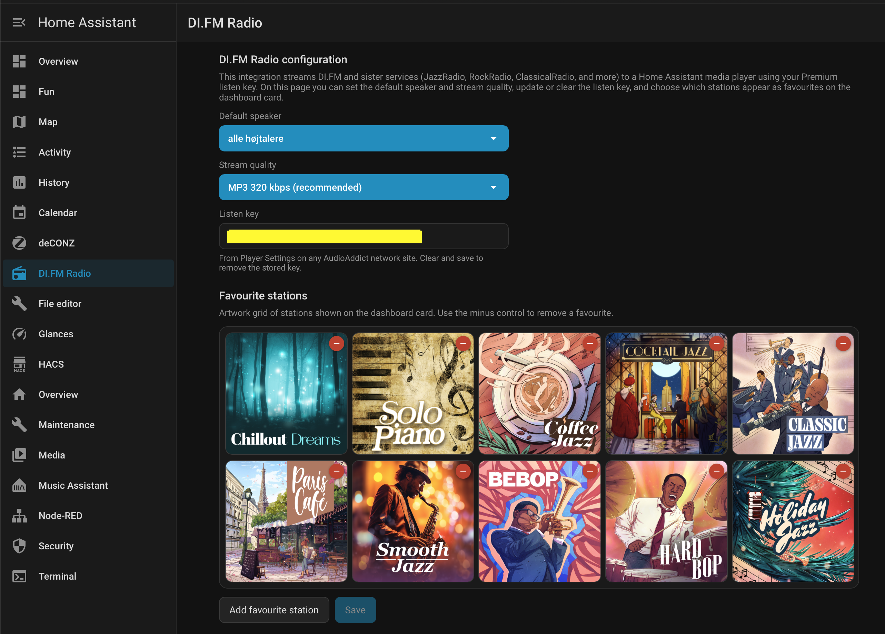
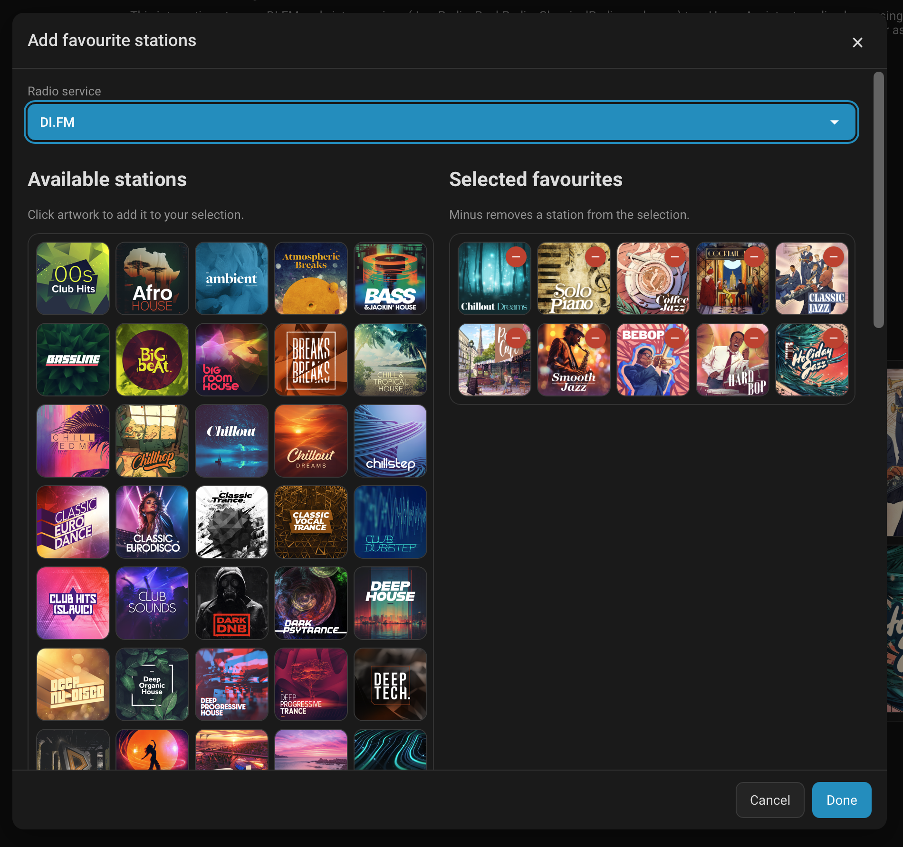
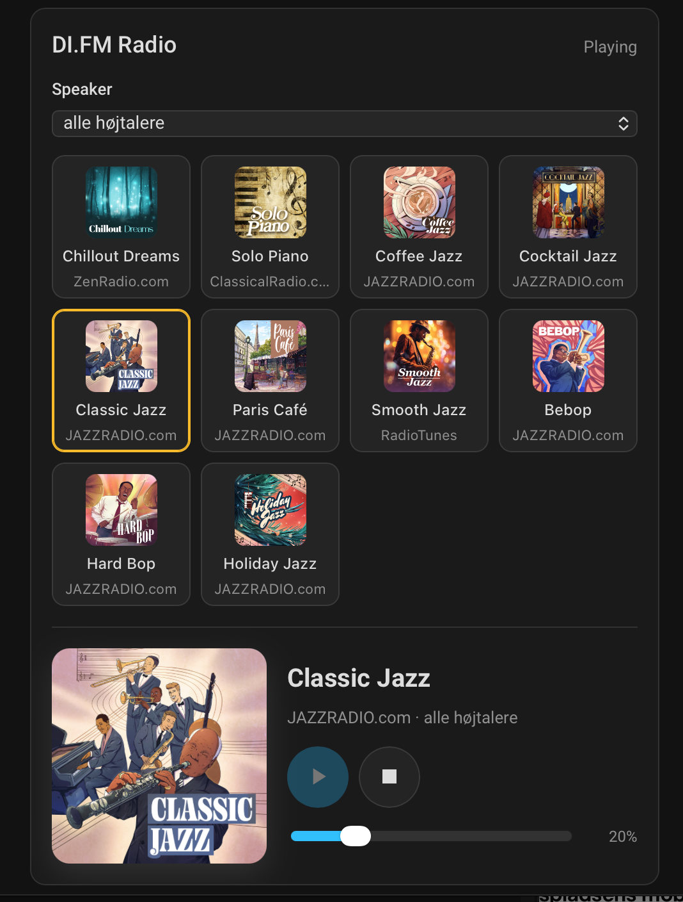

# DI.FM Radio for Home Assistant

Custom integration and Lovelace card for DI.FM and the sister AudioAddict services. It stores a listen key in the config entry, loads the live station catalogue, remembers favourites, and plays a resolved Icecast URL on a Home Assistant speaker through a logical `media_player`.

**Speaker audio has been verified on real Home Assistant media players** with a Premium listen key and Icecast streams (`200 audio/mpeg`).

Minimum Home Assistant version: **2025.1.0**.

[](https://my.home-assistant.io/redirect/marketplace_repository/?owner=thomasbyrdal&repository=HADI.fm&category=integration)
[](https://my.home-assistant.io/redirect/config_flow_start/?domain=difm_radio)

## Features

- Plays DI.FM and sister-service stations on a Home Assistant speaker
- Logical `media_player.di_fm_radio` plus a dedicated favourites sensor for the dashboard card
- Lovelace card with speaker picker, favourite artwork tiles, now playing, and volume
- Settings panel (sidebar **DI.FM Radio**, also opened from **Configure**) for:
  - Default speaker and stream quality
  - Listen key view / edit / clear
  - Favourite stations as a scrollable **5-wide** artwork grid
  - **Add favourite station** dialog with radio-service dropdown and dual available/selected grids
- Services for play, stop, catalogue refresh, and favourite toggles
- Long-session stability: speaker metadata ticks ignored, favourites off the hot path, soft catalogue failures

## Supported radio services

Verified live on 2026-10-24 via `GET https://api.audioaddict.com/v1/networks`:

- DI.FM
- RadioTunes
- JAZZRADIO.com
- ROCKRADIO.COM
- ClassicalRadio.com
- ZenRadio.com

One paid subscription covers every listed service. Sky.fm is not a live network.

## Get a listen key

1. Subscribe at [di.fm/premium](https://www.di.fm/premium) or a sister site.
2. Sign in and open **Settings → Player Settings**.
3. Copy the listen key. Do not put it in card YAML, automations you will share, or Git.

Validation uses:

`GET https://api.audioaddict.com/v1/di/listen/premium_high/trance?listen_key=...`

A request without `listen_key` is public and is not treated as success.

## Install from the Marketplace

Home Assistant’s custom-integration catalogue is now **Settings → Marketplace** (formerly HACS).

1. Open **Settings → Marketplace**.
2. Add this GitHub repository as a **custom repository** of type **Integration** (if it is not already listed).
3. Download **DI.FM Radio**.
4. Restart Home Assistant.
5. Go to **Settings → Devices & services → Add integration → DI.FM Radio**.

See [docs/releasing.md](docs/releasing.md) for GitHub release notes. The repo still ships `hacs.json` so Marketplace can discover the integration.

## Manual / clean install

1. Copy `custom_components/difm_radio` into `<config>/custom_components/difm_radio` so that `manifest.json` is at `<config>/custom_components/difm_radio/manifest.json`.
2. Confirm `www/difm-radio-card.js` and `www/difm-radio-settings.js` are in that folder.
3. Restart Home Assistant.
4. Add the integration from the UI.

## Initial configuration

1. Paste the listen key.
2. Choose which services appear in the favourite picker.
3. Select favourites. Search the dropdown. Order is kept when you edit later.
4. Choose a default `media_player` and a stream quality.

## Settings panel

Open **DI.FM Radio** in the sidebar, or use **Configure** on the integration. The panel lets you:

- Change the **default speaker** and **stream quality**
- View, replace, or clear the **listen key** (Save only when something changed)
- Manage **favourite stations** as artwork tiles (minus to remove)
- **Add favourite station**: pick a radio service, click available artwork to select, remove from the selected grid with minus



**Add favourite station** opens a dialog with a radio-service dropdown and two artwork grids — available stations on the left, selected favourites on the right:



Favourite and options edits do not reload the config entry, so an owned stream is not torn down.

Stream quality (official Premium copy):

| Key | Format |
| --- | --- |
| `premium_high` | MP3 320 kbps (default) |
| `premium` | AAC 128 kbps |
| `premium_medium` | AAC-HE 64 kbps |

## Lovelace card

The card is bundled with the integration. It is **not** installed under `/www/community/` the way older community dashboard plugins were. The file is `custom_components/difm_radio/www/difm-radio-card.js`, served as `/difm_radio/difm-radio-card.js`.

After a restart, Home Assistant should add a Dashboard resource of type **module** for that URL. Then:

1. **Edit dashboard → Add card**
2. Open the **By card** tab (or **Browse all cards**). Searching **DI.FM** on the **By entity** tab only shows built-in media-player tiles.
3. Choose **DI.FM favourite stations**

From Home Assistant 2026.6, selecting the `media_player.di_fm_radio` entity also lists this card under **Community**.

The card layout is:

1. A **speaker** dropdown
2. Favourite stations as artwork icons
3. Large artwork for the selected station, with play, stop, and volume



Do not add the generic media-player tiles (title only, playback controls, volume slider). Those are Home Assistant's built-in cards. The logical player also exposes **Browse media**.

```yaml
type: custom:difm-radio-card
entity: media_player.di_fm_radio
# media_player: media_player.kitchen   # optional speaker override
# columns: 4
# title: DI.FM Radio
# show_names: true
# show_service_labels: true
# show_volume: true
```

Favourites come from the integration entity / favourites sensor. The card never stores the listen key.

If the picker does not list the card, add a Lovelace resource of type **module**: `/difm_radio/difm-radio-card.js`

## Services

| Service | Purpose |
| --- | --- |
| `difm_radio.play_station` | Play `station_id`. Optional `media_player` override |
| `difm_radio.stop` | Stop only if this integration owns the speaker session |
| `difm_radio.refresh_stations` | Reload the catalogue |
| `difm_radio.set_favourite` | Add or remove a favourite by `station_id` |

The logical `media_player.di_fm_radio` also accepts `play_media` with a station id, Stop, and volume when the speaker supports it.

## Known limitations

- One active stream per subscription (DI.FM Terms).
- Icecast mounts use the verified bare `?{listen_key}` form. `?listen_key=` returns 401.
- The integration does not probe Icecast itself; that would consume the only allowed stream.
- Now-playing track metadata is not implemented.
- Remote `favorites.pls` is not imported; favourites are local.
- Some speakers or firmware may still refuse certain AAC qualities; prefer `premium_high` (MP3 320) if playback fails.

## Verified vs unverified

See [docs/api-research.md](docs/api-research.md).

Verified: public catalogue, official artwork, listen-key validation, `/listen` URL lists with the bare-key query, Icecast `200 audio/mpeg`, same key on JazzRadio, **audio on real Home Assistant speakers**.

Unverified: stream expiry behaviour across every CDN mirror, and every speaker firmware accepting every quality key.

## Troubleshooting

See [docs/troubleshooting.md](docs/troubleshooting.md).

## Tests and checks

```bash
python3.12 -m pip install -e ".[test]"
python3.12 -m ruff check custom_components tests
python3.12 -m pytest
```

```bash
cd frontend
npm ci
npm run typecheck
npm test
npm run build
```

CI does not use a real listen key. Config-flow tests in `tests/test_config_flow.py` run only when `homeassistant` is installed.

## Still requires a listen key or a login

These were not completed automatically in this repository:

| Item | Why |
| --- | --- |
| Copy onto a private Home Assistant instance | Needs local credentials; not stored in this repo |
| Type a listen key in the UI | The key must be entered locally; it is not stored in this repo |
| Marketplace default catalogue listing | Needs the public GitHub repository and releases (custom repository works today) |

## Report issues

Use GitHub Issues. Do not include your listen key, stream URLs that contain it, or account passwords.

## Licence

MIT. See [LICENSE](LICENSE).
